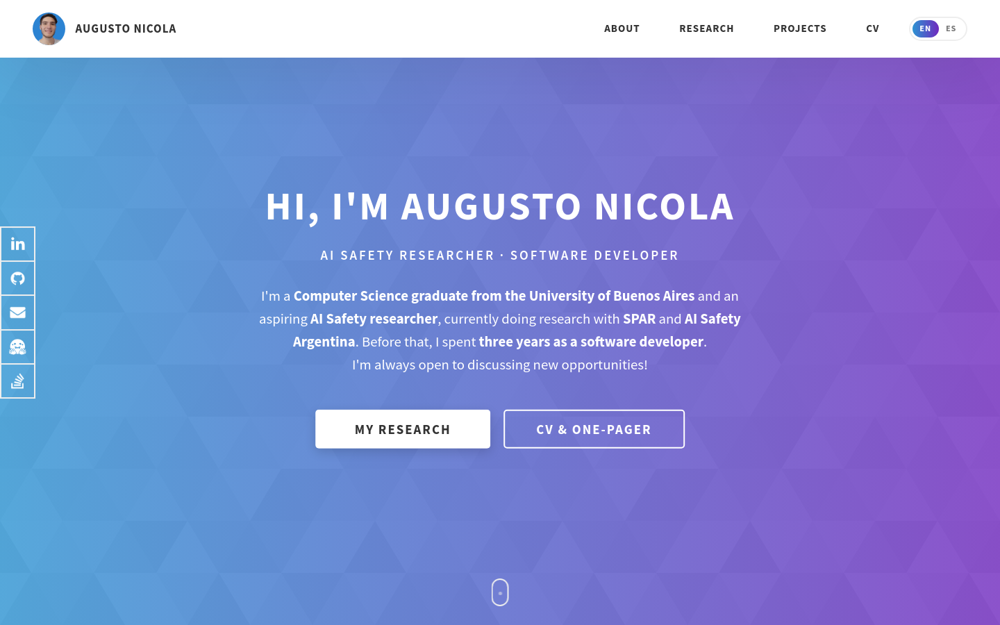

# **Portfolio**

### *My personal portfolio website for presenting my projects and tools.*

### **Live Version: https://augustonicola.netlify.app**

 

### [README en español acá :argentina: :mexico:](README.md)

 

This is the source code for my personal portfolio website, in which I present information about my aptitudes and experience. Made with [Astro](https://astro.build) and SCSS, available in English and Spanish.

The design is heavily based off [Ram Maheshwari's](https://github.com/rammcodes) own portfolio template, ["Dopefolio"](https://github.com/rammcodes/Dopefolio).

The icons used throughout the project are property of [Font Awesome](https://fontawesome.com/) and [Simple Icons](https://simpleicons.org/).

 

# Installation and Local Usage
In order to locally edit the website, please follow these steps:

1. **Clone the repository and move to the target directory**
	
		$ git clone https://github.com/AugustoNicola/Portfolio
		$ cd Portfolio/

2. **Create an environment with Node.js 22 (Astro requires Node ≥ 22.22) and install the dependencies**

		$ conda create -n portfolio -c conda-forge "nodejs>=22.22,<23"
		$ conda activate portfolio
		$ npm install

That's it, the project should be ready to use!

 

## Commands

* `npm run dev`: Starts a development server at `http://localhost:4321` with hot reload.
* `npm run build`: Builds the static site into `dist/` (this is what Netlify runs).
* `npm run preview`: Serves the contents of `dist/` locally.

## Structure

* `src/data/`: All of the site's content (bio, research, training, projects, and links), in both English and Spanish.
* `src/i18n.ts`: UI strings in both languages. English lives at `/` and Spanish at `/es/`.
* `src/components/`: Page sections; `src/styles/`: SCSS styles; `src/icons/`: tool SVG icons.

 

# Contributing and License
This work is licensed under the [GPL v3.0 License](https://choosealicense.com/licenses/gpl-3.0/). You are free to read, use or modify any part you want, **but it is required that you mantain this same license and make publicly available any modifications made.**

Any contribution by submitting code, notifying bugs, suggestions or any other way is always greatly appreciated.

Once again, many thanks to Ram Maheshwari for creating and sharing the Dopefolio template in which this work is heavily based :raised_hands:

¡I hope you've liked my work! :+1: